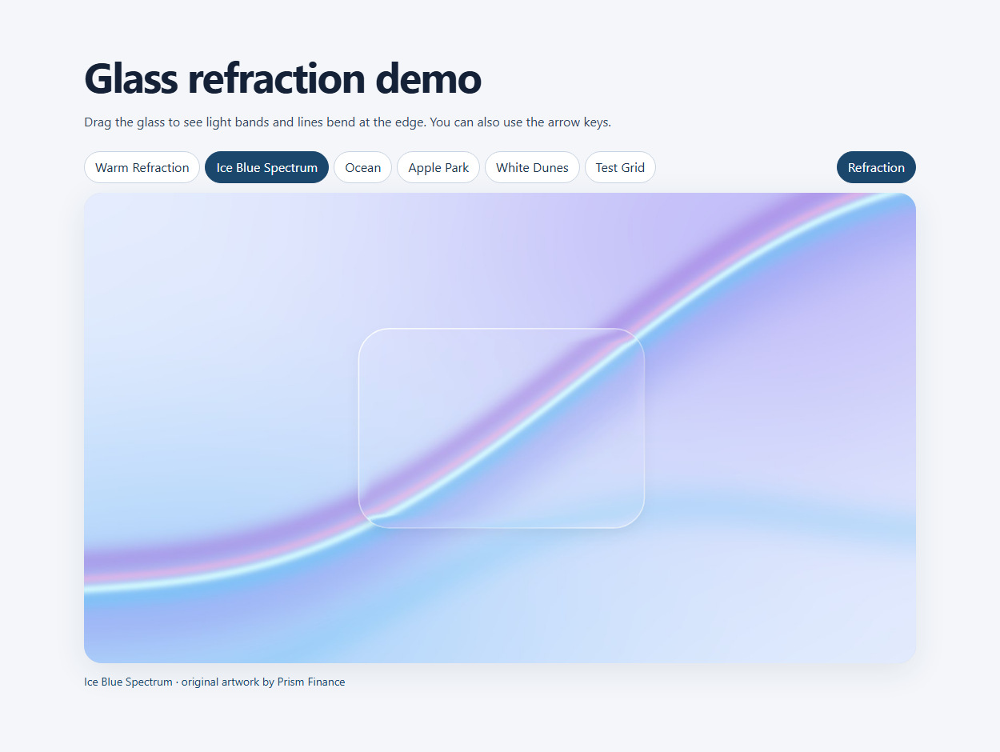
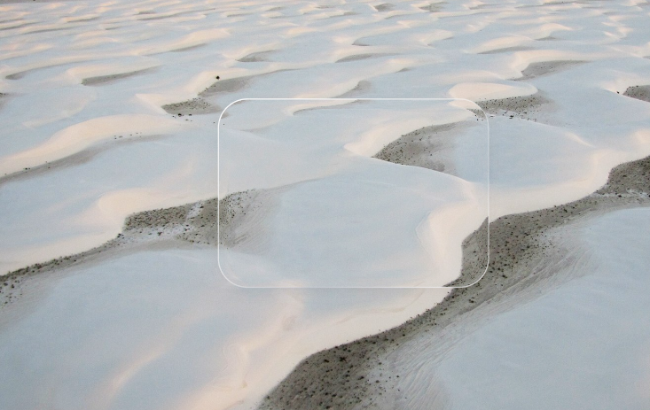
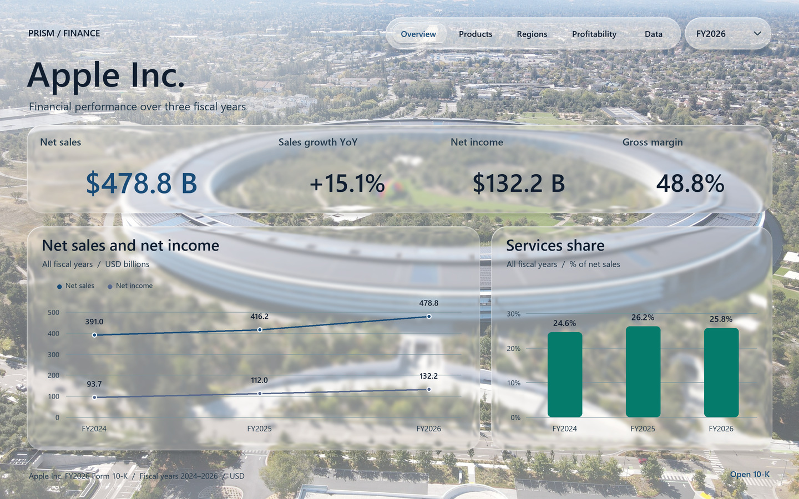
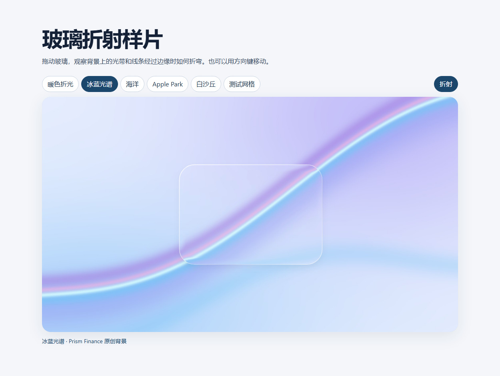
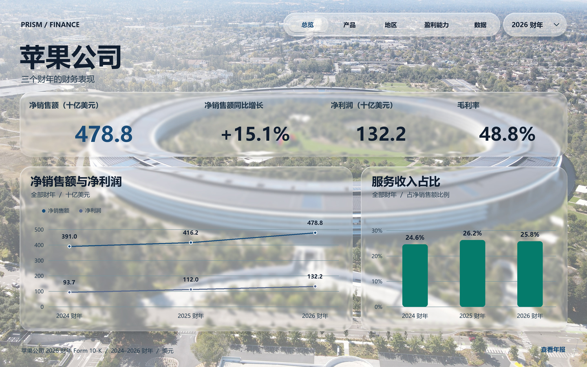

# Liquid Glass BI Dashboard Design

[English](#english) · [简体中文](#中文)

## English

### Project overview

Prism Finance is an open-source Power BI dashboard design inspired by Apple’s Liquid Glass. Translucent, rounded panels let the background show through. Soft Gaussian blur reduces detail beneath charts, and subtle refraction bends lines as they cross the glass rim. The project includes a five-page Power BI report and an interactive HTML demo for inspecting the refraction up close.

[Download the English edition](liquid-glass-bi-dashboard-design-en.zip?raw=true)

### Interactive HTML demo

Extract the ZIP and open `assets/glass-demo-en.html` in a browser. The five backgrounds are embedded in the file for offline use. Choose Warm Refraction, Ice Blue Spectrum, Ocean, Apple Park, or White Dunes. Drag the glass or focus it and use the arrow keys. The Refraction switch lets you compare the same position with the effect on and off. The extra Test Grid makes small shifts along straight lines easier to see.

#### How the refraction works

The demo renders a second copy of the same background inside a rounded SVG clip. It calculates horizontal and vertical offsets from the shape of the glass rim and encodes them in the red and green channels of a displacement map. SVG’s `feDisplacementMap` uses those channels to resample the background near the rim. The offsets taper toward the center, where an unshifted copy of the scene preserves the view through the glass. Rim highlights and a soft shadow give the panel depth as you move it.

*The Ice Blue Spectrum scene with refraction enabled.*

*The White Dunes scene. Background photograph by the U.S. National Park Service.*

### Power BI dashboard

The report uses publicly filed Apple Form 10-K data for fiscal years 2024–2026. Its five pages cover the financial overview, products and services, geographic performance, profitability, and detailed financial data. A synchronized fiscal-year slicer connects the pages. The annual trend charts and consolidated financial table retain all three years for comparison.

The Power BI canvas uses pre-rendered glass backgrounds with Gaussian blur and edge refraction. Charts, tables, slicers, and page navigation are editable Power BI elements. The ZIP includes the theme JSON, background rendering script, and semantic model, so you can reuse the styling or inspect how the report is built.

*Design preview of the Overview page.*

Extract the entire ZIP and open `PrismFinance.pbip` in Power BI Desktop for Windows. Keep the project file alongside the report and semantic model folders. If visuals are empty on first launch, select **Home → Refresh** to load the included data snapshot.

## 中文

### 总体介绍

Prism Finance 是一套受 Apple 液态玻璃启发的开源 Power BI 看板设计。透明圆角面板保留底图的光线和纹理，柔和的高斯模糊弱化图表下方的细节，底图的线条经过玻璃边缘时会轻微偏折。项目包含五页 Power BI 看板和一个可离线打开的 HTML 交互样片，可近距离观察折射如何随玻璃位置变化。

[下载中文版](liquid-glass-bi-dashboard-design-Chinese.zip?raw=true)

### HTML 交互样片

解压 ZIP 后，用浏览器打开 `assets/glass-demo.html`。暖色折光、冰蓝光谱、海洋、Apple Park 和白沙丘五种背景已内嵌在 HTML 中。可以拖动玻璃，也可以选中玻璃后用方向键移动。点击「折射」开关，可在同一位置对照开启和关闭的画面。样片还提供测试网格，便于观察直线经过玻璃边缘时的细微偏移。

#### 折射原理

样片在 SVG 圆角裁剪区域内绘制一层与外部对齐的背景，根据玻璃边缘的形状计算水平和垂直采样偏移，再将偏移写入位移图的红、绿通道。SVG 的 `feDisplacementMap` 读取这两个通道，对边缘附近的底图重新采样。偏移量向内逐渐衰减，中央保留原始画面。边缘高光和柔和阴影随玻璃一起移动，呈现透明面板的厚度。

*冰蓝光谱场景，已开启折射。*

*白沙丘场景。背景照片来自美国国家公园管理局。*

### Power BI 看板

看板使用 Apple 公开的 Form 10-K 数据，覆盖 2024 至 2026 财年。五页内容包括财务总览、产品与服务、地区表现、盈利能力和数据明细。财年切片器在页面之间同步，年度趋势图和合并财务表保留三个财年，便于跨年比较。

Power BI 画布使用预渲染的玻璃底图，保留高斯模糊和边缘折射。图表、表格、切片器及页面导航均为可编辑的 Power BI 元素。压缩包内还提供主题 JSON、底图渲染脚本和语义模型，方便复用视觉样式或查看看板的实现。

*财务总览页设计预览。*

完整解压 ZIP 后，用 Windows 版 Power BI Desktop 打开 `PrismFinance-ZH.pbip`，保留报表、语义模型文件夹与项目文件的相对位置。若首次打开时图表为空，在 **主页 → 刷新** 加载随包附带的数据。

## License / 许可

The original report definitions, code, and documentation are MIT licensed. Photography credits, their respective licenses, and the data source are documented in each ZIP.

原创报表定义、代码和文档采用 MIT 许可。照片署名、各自的许可和数据来源见压缩包内的说明。
